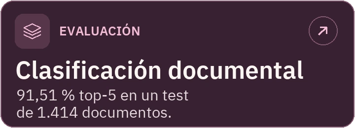
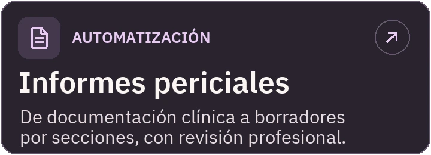
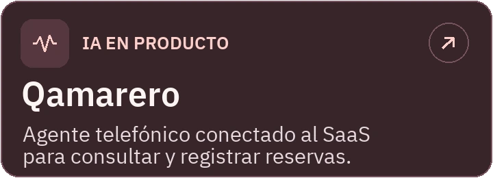
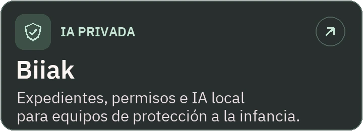

# Ingeniería de IA en producción

Soy cofundador y líder técnico de **TenBeltz**. Trabajo con pymes de servicios profesionales y despachos para automatizar tareas con documentos, informes y herramientas de gestión. También ayudo a equipos de software a integrar IA en sus productos.

  
  
  

## Proyectos seleccionados

  
  
  
  

## Cómo trabajo

Empiezo por una tarea concreta y la pruebo con ejemplos del trabajo diario. En producción me fijo en la calidad de las respuestas, qué se puede comprobar con trazas y cuánto cuesta cada ejecución.

**IA aplicada** · RAG con fuentes consultables, agentes conectados a herramientas y modelos locales con `vLLM`.

**Ingeniería de producto** · `Python` · `FastAPI` · `Django` · `TypeScript` · `PostgreSQL` · `Docker`

**Evaluación y operación** · Casos de prueba para detectar regresiones, trazas con `Langfuse` y coste por tarea.

## Docencia y reconocimiento

Imparto formación en IA aplicada a empresas y equipos técnicos.

Con **SustainaAI** gané el primer premio de **Provider 2025** en BIC Bizkaia.
